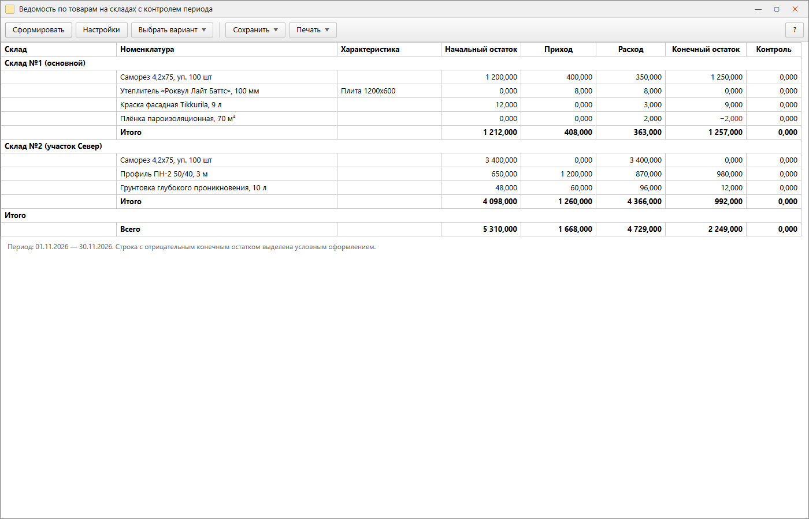
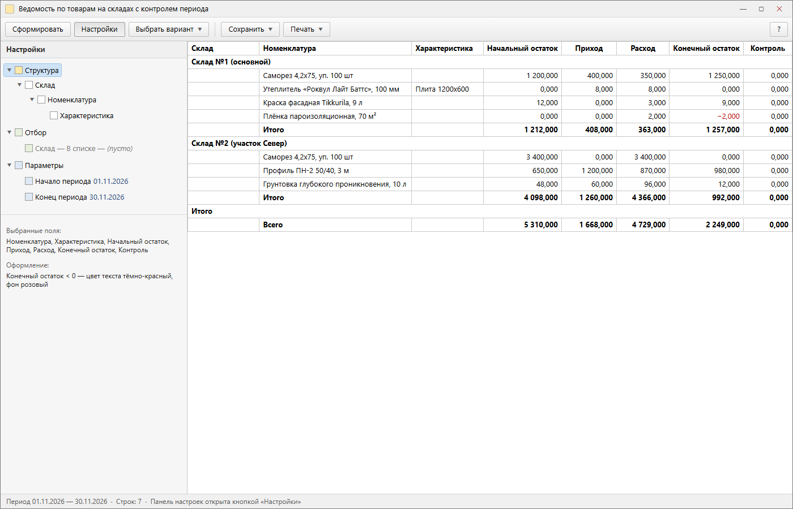

# Демо для технического собеседования: отчёт на СКД

**Сайт демо:** https://kepanasyuke.github.io/1c-report-demo/ ·
**Репозиторий:** https://github.com/kepanasyuke/1c-report-demo

**Если сайт не открывается** (GitHub Pages в части сетей режется на TLS),
двойной клик по `Открыть сайт.cmd` в корне проекта — та же страница
поднимется из `docs\index.html` в браузере, работает без интернета.

Вакансия просит «презентацию любой собственной обработки или отчёта». Здесь
лежит готовая к показу работа: ведомость по товарам на складах с контролем
арифметики периода, отчёт на СКД плюс пример обмена по JSON/HTTP. Оба файла
оформлены по вашим правилам: один выход из функции, тело функции в одну-две
инструкции, без `Прервать`, `Продолжить`, `Перейти`, `Пока`.

## Состав

```
src/МодульОбъекта.bsl    модуль объекта отчёта (компоновка, параметры периода)
src/Запрос.txt           текст запроса для набора данных СКД + обоснование его записи
src/СхемаСКД.md          пошаговая сборка схемы: поля, ресурсы, параметры, оформление
src/ИнтеграцияJSON.bsl   второй экран: обмен JSON/HTTP в том же стиле
tools/check-style.ps1    проверка правил оформления по всем .bsl
mockup/taksi-8-3-10/     HTML-макеты интерфейса 8.3.10 «Такси» (исходники скринов)
docs/screens/            PNG-скрины для этого README
```

Сборка отчёта целиком описана в `src/СхемаСКД.md` — 10 минут в Конфигураторе,
заканчивается файлом `ВедомостьПоТоварамНаСкладах.erf`.

## Скрины

Всё оформлено под интерфейс **1С 8.3.10 «Такси»** (2014): плоские кнопки на
командной панели, серая шапка окна, тонкие серые рамки таблицы 1 px, жирные
строки группировок и итогов, красный цвет у отрицательного остатка.





**Важно про происхождение картинок.** 1С на этой машине не установлена, поэтому
это не фотографии живой базы, а макеты, отрисованные из HTML
(`mockup/taksi-8-3-10/report.html` и `settings.html`) в PNG через Chrome.
Показывать их как «скриншот моего отчёта» на собеседовании нельзя — в макете
выдуманные данные и нет реальной сетки платформы.

### Как заменить макеты настоящими скринами

1. Установить платформу 8.3.10 (или ближайшую из линейки 8.3.10–8.3.13) и
   собрать `.erf` по `src/СхемаСКД.md`.
2. Включить тот же интерфейс: `Сервис → Параметры → Общие → Использовать
   интерфейс «Такси»`, масштаб 100 %, тема оформления по умолчанию «1С».
3. Снять три кадра, имена — как в этом README:
   - `01-otchet-taksi-8-3-10.png` — сформированный отчёт с раскрытыми
     группировками и видимой строкой с минусовым остатком;
   - `02-nastroyki-taksi-8-3-10.png` — окно с открытой панелью «Настройки»
     (структура, отбор, параметры периода);
   - `03-shape-scheme.png` — вкладка «Ресурсы» схемы компоновки, если спросят
     про ресурсы и вычисляемые поля.
4. Положить файлы в `docs/screens/` с теми же именами — README подхватит их без
   правок. Пункт про макеты из этого раздела тогда удалить.

## Проверка стиля

```powershell
powershell -ExecutionPolicy Bypass -File tools\check-style.ps1
```

Текущий результат: `Проверено файлов: 2, Ошибок: 0, предупреждений: 0`.
Скрипт проверяет: ровно один `Возврат` и только последней инструкцией, запрет
`Возврат` в процедурах, длину тела функции (2 инструкции — норма, 4 — предел),
запрещённые `Прервать` / `Продолжить` / `Перейти` / `Пока`, запрет `Сообщить()`,
отступы пробелами вместо табуляции.

## Что показывать и в каком порядке (7 минут)

1. **Задача (30 с).** Складской учёт закрывает месяц по остаткам; бухгалтерии
   нужна ведомость с начальным остатком, приходом, расходом и конечным
   остатком — и с гарантией, что арифметика строки сходится.
2. **Почему отчёт, а не обработка (30 с).** Отчёт на СКД: пользователь сам
   строит разрезы, не требуется доработка под каждое новое требование.
3. **Запрос (1,5 мин).** Открыть `src/Запрос.txt`: одно обращение к
   `ОстаткиИОбороты` вместо двух обращений к `Остатки`, фильтр по нулевым
   строкам в `ГДЕ`, отборы вынесены в настройки СКД, ни одного обращения через
   точку. Это тезисы про производительность — их в вакансии спрашивают прямо.
4. **Схема (1,5 мин).** Ресурсы через `Сумма()`, вычисляемое поле `Контроль`
   (`НачальныйОстаток + Приход - Расход - КонечныйОстаток` — в каждой строке
   обязан быть ноль), параметры периода, группировки `Склад → Номенклатура →
   Характеристика`, условное оформление отрицательного остатка.
5. **Модуль (1,5 мин).** `ПриКомпоновкеРезультата` собирает результат вручную:
   `КомпоновщикМакетаКомпоновкиДанных` → `ПроцессорКомпоновкиДанных` →
   `РезультатКомпоновкиДанных.Вывести()`. Плюс подстановка текущего месяца,
   если период не заполнен. Обратить внимание: каждое обращение к платформе
   вынесено в однооператорную функцию, поэтому весь код читается сверху вниз
   без ветвлений.
6. **Интеграция (1 мин).** `src/ИнтеграцияJSON.bsl`: `HTTPСоединение` +
   `ЗаписьJSON`/`ЧтениеJSON`, проверка кода состояния, те же правила стиля.
7. **Ограничения (1 мин).** Что сознательно не сделано: нет СКД-вариантов под
   роли, нет истории изменения остатков, `Контроль` не заменяет проверку
   регистра. Это показывает, что вы видите границы решения.

## Чего в демо нет и почему

- **Стиль сайта компании** не применён: в вакансии не назван работодатель,
  ссылки на сайт нет. Пришлите адрес — переодену код и README под их гайд.
- **Правила линтера** взяты ваши, из сообщения. Если у компании есть свой
  `bsl-language-server.json`, положите его в `tools/` — конфликт правил
  разберу по нему.
- **1С на этой машине не установлена** (проверено: ни `1cv8`, ни каталогов
  `Program Files\1cv8`), поэтому код проверен статически: чекером стиля и
  разбором синтаксиса. Сборку `.erf` и первый запуск нужно сделать в вашей
  базе по `src/СхемаСКД.md`.
- Одна платформенная зависимость изолирована в функции `ТекущиеНастройки()`
  (`КомпоновщикНастроек`). Если ваша сборка платформы её не знает — замена на
  `НастройкиКомпоновкиДанных` описана в конце `src/СхемаСКД.md`.
